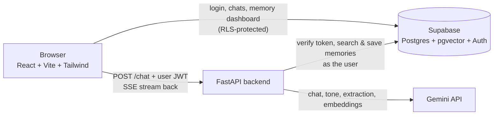

# ✦ Celeste

Celeste is a conversational AI companion you can talk to about anything, built to feel like a thoughtful friend rather than a customer-support bot. She remembers what matters to you, adapts her personality, reads the mood of a conversation, and puts you in control of everything she knows about you.

> Live demo: _coming soon_

## Screenshots

| Chat | Memory & privacy |
|---|---|
|  |  |

## Features

- **Streaming chat** with replies appearing word by word (server-sent events)
- **Five switchable personalities**: funny friend, calm listener, honest friend, intellectual, motivator
- **Long-term semantic memory**: lasting facts are extracted from conversations, stored as vector embeddings, and retrieved by *meaning* (not keywords) when relevant
- **Tone awareness**: a classifier reads the mood of the conversation and overrides the selected personality's humor when someone is struggling
- **Memory & privacy dashboard**: see every memory, delete any of them, switch memory off, or delete all conversations
- **Accounts with strict per-user isolation** enforced in the database, not just in the UI
- **Voice**: speak your messages and have replies read aloud (Web Speech API)
- **Evaluation suite** that measures tone detection, memory extraction, retrieval and personality consistency
- Users can permanently delete their account, which removes their conversations, memories and settings from the database. Prompts already sent to the Gemini API are governed by Google's terms and can't be recalled by this app.

## Architecture



### What happens when you send a message

1. The frontend sends the conversation and the user's Supabase JWT to the backend.
2. The backend verifies the token with Supabase.
3. **In parallel**: the message is embedded and the closest stored memories are retrieved (pgvector cosine similarity), and a classifier labels the mood (`light`, `neutral`, `serious`, `distressed`).
4. A system prompt is assembled from the personality, the relevant memories, and a mood directive, then the reply streams back token by token.
5. After the response finishes, a **background task** extracts durable facts from the exchange, skips duplicates, embeds the new ones and saves them. This never slows down the reply.

## Tech stack

| Layer | Technology |
|---|---|
| Frontend | React, Vite, Tailwind CSS v4, react-markdown, lucide-react |
| Backend | Python, FastAPI, httpx |
| LLM and embeddings | Google Gemini API (`gemini-embedding-001` at 768 dimensions) |
| Database and auth | Supabase: Postgres, pgvector, Row-Level Security, email auth |
| Voice | Web Speech API (recognition and synthesis) |

## Design decisions

- **Row-Level Security does the isolation.** Every table has RLS policies, and the backend calls Supabase *with the user's own token*, so it never holds a privileged `service_role` key. A bug in the API layer can't leak another user's data.
- **Memory is selective by design.** The extraction prompt keeps durable facts (interests, projects, goals, relationships) and refuses temporary moods, small talk, and sensitive categories such as health, finances, religion, politics and precise location.
- **Retrieval, not replay.** Only the few memories relevant to the current message are injected into the prompt, instead of the whole history.
- **Duplicate suppression.** New facts are compared with existing ones by embedding similarity, so restating something doesn't create another row.
- **Concurrency.** Memory lookup and tone detection run together with `asyncio.gather` to hide the extra latency.
- **Fail-safe features.** Memory and tone are enhancements: if either fails, chat still works.
- **Swappable LLM provider.** All model calls live in `backend/llm.py`; changing providers means rewriting that one file.
- **Embedding task types.** Stored facts and search queries are embedded with different task types, as recommended for retrieval.

## Getting started

### Prerequisites

- Node.js 20.19+ (or 22.12+)
- Python 3.11+
- A free [Supabase](https://supabase.com) project
- A free Gemini API key from [Google AI Studio](https://aistudio.google.com)

### 1. Clone

```bash
git clone https://github.com/hazelbenny/ai-companion.git
cd ai-companion
```

### 2. Database

In the Supabase dashboard, open the **SQL Editor** and run [`supabase/schema.sql`](supabase/schema.sql). For local development you can turn off **Confirm email** under Authentication settings.

### 3. Backend

```bash
cd backend
python3 -m venv venv
source venv/bin/activate
pip install -r requirements.txt
cp .env.example .env     # then fill in your keys
python -m uvicorn main:app --reload
```

| Variable | Purpose |
|---|---|
| `GEMINI_API_KEY` | Google AI Studio key |
| `MODELS` | Comma-separated chat models, tried in order (first is preferred) |
| `FAST_MODELS` | Lighter models for tone detection and memory extraction |
| `SUPABASE_URL` | Your Supabase project URL |
| `SUPABASE_ANON_KEY` | Your Supabase anon/publishable key |
| `EVAL_EMAIL`, `EVAL_PASSWORD` | _Optional_: a throwaway account for the memory evaluation suite |

### 4. Frontend

```bash
cd frontend
npm install
cp .env.example .env     # then fill in your keys
npm run dev
```

| Variable | Purpose |
|---|---|
| `VITE_SUPABASE_URL` | Your Supabase project URL |
| `VITE_SUPABASE_ANON_KEY` | Your Supabase anon/publishable key |
| `VITE_API_URL` | _Optional_: backend URL (defaults to `http://localhost:8000`) |

Open http://localhost:5173, create an account and start talking.

## Evaluations

LLM features can't be verified with ordinary unit tests, so the project ships an evaluation suite. From `backend/`:

```bash
python -m evals.run_evals                    # all suites
python -m evals.run_evals --suite tone       # tone, extraction, recall or personality
```

| Suite | What it checks |
|---|---|
| `tone` | Mood classification on playful, neutral and distressed messages |
| `extraction` | Durable facts are captured; small talk, plain questions and sensitive details are not |
| `recall` | End to end against the real database: facts are stored, the relevant one is retrieved, unrelated queries retrieve nothing, restated facts aren't duplicated |
| `personality` | An LLM judge checks each personality is recognisable; hard checks confirm a serious mood strips emoji and jokes even from the funny personality, and that a request to lighten the mood gets answered |

The recall suite signs in as a dedicated test account (`EVAL_EMAIL` / `EVAL_PASSWORD`) and **deletes that account's memories afterwards**, so never point it at a real account.

Latest results: _fill in after running_

**Limitations of the evaluation:** model outputs vary run to run, the judge is the same model family as the system under test (which can bias it), and the cases are a small hand-written sample, so treat it as a regression check rather than a benchmark.

## Privacy

- Memory is on by default but can be switched off at any time; when off, nothing is saved or retrieved.
- Users can view and delete individual memories, delete all memories, and delete all conversations.
- Data is isolated per user at the database level.
- Voice input uses the browser's speech recognition. In Chrome, audio is processed by Google's speech service.
- On the Gemini API free tier, prompts may be used by Google to improve its products. Avoid sharing sensitive information while using a free-tier key.

## Known limitations

- Voice input works best in Chrome. Safari needs Siri and Dictation enabled; Firefox has no speech recognition.
- Tone detection is an LLM judgment and occasionally misclassifies.
- Free-tier model quotas can cause slow or failed replies during busy periods; the backend retries and falls back to other models.
- Each message makes several model calls (embedding, tone, reply, extraction), which is a cost consideration at scale.

## Roadmap

- Export my data (memories and conversations as JSON)
- Show when a reply used a memory
- Personality-specific check-in styles after heavy moments
- Real-time voice conversations
- Rate limiting and CI running the evaluation suite